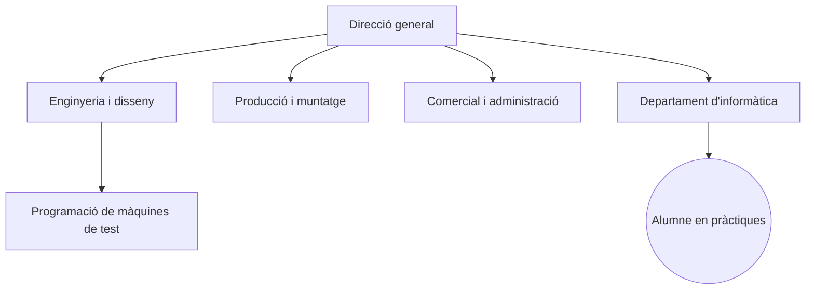
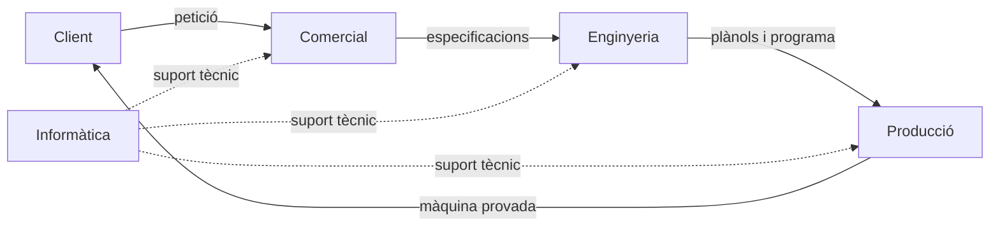

# Ac2: Anàlisi estratègica del sector i noves oportunitats de negoci

**Alumne:** John
**Cicle:** ASIX
**Empresa de pràctiques:** Sistemas Integrados Electroneumáticos, S.L. (SIE Group)

---

## 1. Identificació de l'empresa

| Camp                             |  | Dada                                                                                                                                |
| -------------------------------- | - | ----------------------------------------------------------------------------------------------------------------------------------- |
| Nom                              |  | Sistemas Integrados Electroneumáticos, S.L. (nom comercial: SIE Group)                                                             |
| Localització                    |  | Carrer Fusters, 47, 43800 Valls (Tarragona)                                                                                         |
| Activitat principal              |  | Disseny i fabricació d'equips de test electroneumàtics per verificar i controlar cablejat de l'automoció i indústries auxiliars |
| Tipus jurídic                   |  | Societat Limitada (SL), constituïda el 10 de febrer de 2005                                                                        |
| Nombre aproximat de treballadors |  | Entre 11 i 50 (algunes fonts parlen d'unes 15 persones)                                                                             |
| Sector econòmic                 |  | Secundari (indústria / fabricació de maquinària i equips)                                                                        |

**Contextualització:** SIE Group pertany al sector dels components d'automoció. Dissenya, fabrica, programa i repara màquines de test que comproven que els mazos de cables (cablejat) de vehicles funcionen correctament abans d'arribar al client final. També dona servei a les indústries aeroespacial i d'electrodomèstics, i té vinculació amb una empresa germana a Mèxic.

Es classifica dins del **sector secundari** perquè transforma components en un producte industrial (màquines de test) i no només ven serveis. Va adoptar la forma d'**SL** perquè limita la responsabilitat dels socis al capital aportat i és la fórmula habitual en pimes industrials._

---

## 2. Estructura organitzativa

### 2.1 Tipus d'estructura **[CONFIRMAR]**

Per la seva mida, l'empresa té una **estructura funcional i poc jeràrquica**: poques capes de comandament, amb persones agrupades per àrea d'especialitat (enginyeria i disseny, producció i muntatge, programari, comercial/administració i informàtica) i amb comunicació directa amb la direcció. Aquest model és adequat per a una pime perquè agilitza les decisions i permet respondre ràpid a les peticions de cada client, tot i que concentra molta responsabilitat en poques persones.

### 2.2 Organigrama **[CONFIRMAR amb el tutor]**

### 2.3 Rellevància del meu lloc dins l'organigrama

Faig les pràctiques al **departament d'informàtica**, que dona suport transversal a totes les àrees: equips, xarxa, programari de disseny i programació, còpies de seguretat i comunicació amb clients. Encara que no produeix directament les màquines, és imprescindible perquè totes les altres àrees puguin treballar.

---

## 3. Departaments i funcions

### 3.1 Llistat de departaments

| Departament                | Descripció                                                       | Funcions clau                                                                           |
| -------------------------- | ----------------------------------------------------------------- | --------------------------------------------------------------------------------------- |
| Direcció general          | Defineix l'estratègia i pren les decisions principals            | Planificació, relació amb clients importants, gestió de recursos                     |
| Enginyeria i disseny       | Dissenya els equips de test segons les necessitats de cada client | Esquemes elèctrics i pneumàtics, plànols, programació del test                      |
| Producció i muntatge      | Fabrica i munta les màquines                                     | Muntatge, cablejat, proves, reparació i manteniment                                    |
| Comercial i administració | Gestiona clients, compres i economia                              | Pressupostos, comandes, facturació, comptabilitat                                      |
| Informàtica (TIC)         | Manté la infraestructura tecnològica de l'empresa               | Suport a usuaris, xarxa, servidors, còpies de seguretat, seguretat, programari tècnic |

### 3.2 Relacions i fluxos de comunicació

La comunicació és directa i àgil, típica d'una pime: converses presencials, correu i trucades, amb reunions per projecte. Exemple del flux d'una comanda d'una màquina de test:

---

## 4. Experiència personal

### 4.1 Integració dins l'organització

Em vaig incorporar al departament d'informàtica d'una empresa petita, on l'ambient de treball és proper i el tracte amb les altres àrees és directe. Això ha facilitat que em senti part de l'equip des dels primers dies i que pugui preguntar dubtes a qualsevol persona. Treballo en estreta col·laboració amb el responsable del departament, que m'ha anat assignant tasques de dificultat creixent.

### 4.2 Aportació des de la meva posició

Des d'informàtica he col·laborat en tasques de suport als usuaris, manteniment d'equips i xarxa, i organització de la documentació tècnica. El valor que aporto és alliberar temps als treballadors d'enginyeria i producció perquè es concentrin en la seva feina, i aplicar els coneixements d'ASIX en situacions reals de l'empresa.

### 4.3 Punts forts organitzatius

- Comunicació directa i ràpida entre departaments, sense burocràcia excessiva.
- Alta especialització tècnica: l'empresa domina un nínxol concret i de valor (equips de test electroneumàtics).
- Ambient proper que afavoreix l'aprenentatge d'un alumne en pràctiques.

### 4.4 Àrees de millora

- Documentar i formalitzar més els procediments (per exemple, un registre d'incidències informàtiques) perquè el coneixement no depengui només de persones concretes.
- Reforçar la seguretat informàtica i les còpies de seguretat, essent una empresa amb dissenys i programes valuosos per als clients.
- Disposar d'un organigrama i d'uns rols més definits, que ajudarien a la incorporació de nou personal.

### 4.5 Coherència entre estructura i activitat

L'estructura funcional i lleugera és coherent amb una pime industrial que fabrica equips a mida: cada àrea cobreix una fase del procés (disseny, producció, venda) i informàtica dona suport a totes. La mida reduïda permet flexibilitat, tot i que obliga que algunes persones assumeixin diverses funcions.

---

## Annex: fonts consultades

- Registres mercantils i directoris d'empreses (constitució 2005, SL, domicili a Valls, rang de plantilla).
- Perfil públic de l'empresa a LinkedIn / JOIN (activitat i missió).
- Web de l'empresa: www.sie-group.es
